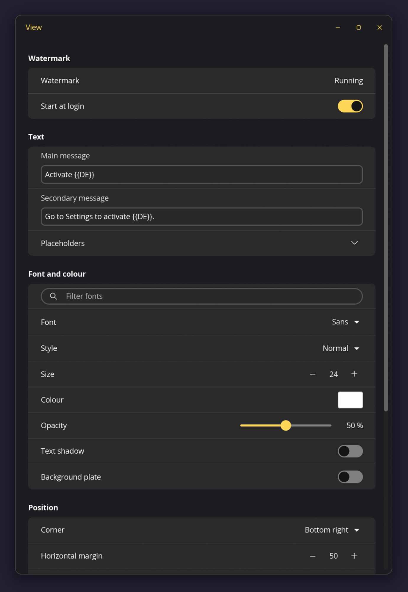

# Activate Linux for COSMIC™

An "Activate Windows"-style watermark for the COSMIC™ desktop: a native port of
[Activate Linux for GNOME](https://github.com/bbbenji/gnome-shell-extension-activate-linux).
It is a community project and is not affiliated with or endorsed by System76.




## Features

- Custom main and secondary text with placeholders
- Font family, style, size, colour and opacity; optional text shadow and background plate
- Any corner, with horizontal and vertical margins
- Automatic display, all displays, or one display chosen by connector name
- On the desktop (below windows), over all windows, and optionally on the lock screen
- A command you can bind to a shortcut to toggle "over all windows"

## How it works

COSMIC has no shell extensions. Instead:

- `cosmic-ext-activate-linux-daemon` draws the watermark as a click-through
  layer-shell surface. It starts at login through `/etc/xdg/autostart`.
- `cosmic-ext-activate-linux` is the settings app.

Both read and write `~/.config/cosmic/io.github.bbbenji.ActivateLinux/v1/`, and
the watermark follows changes immediately.

**Native packages only.** COSMIC offers layer-shell (and lock-screen layers)
only to unsandboxed apps, so a Flatpak build couldn't draw the watermark.

**Automatic display.** The watermark is created on whichever output is active
at that moment and stays there. If that output is unplugged, it reappears on
the then-active one.

## Installation

Requirements: Rust ≥ 1.93, [just](https://github.com/casey/just), and the usual
libcosmic build dependencies (`pkg-config`, `libxkbcommon`, `wayland`, `libinput`,
`udev`, `dbus`, `fontconfig`, `expat` development packages).

```sh
git clone https://github.com/bbbenji/cosmic-ext-activate-linux.git
cd cosmic-ext-activate-linux
just build-release
sudo just install
```

Start it now with `cosmic-ext-activate-linux-daemon &`. From the next login it
starts automatically. On systemd systems the user manager often survives a
logout, so either reboot once or run `systemctl --user daemon-reload` to pick up
the new autostart entry.

To remove it: `sudo just uninstall`.

## Configuration

Open **Activate Linux** from the app library.

### Placeholders

Case-insensitive:

| Placeholder       | Value                                 |
| ----------------- | ------------------------------------- |
| `{{OS}}`          | Operating system name, e.g. `CachyOS` |
| `{{KERNEL}}`      | Kernel release                        |
| `{{DE}}`          | `$XDG_CURRENT_DESKTOP`, e.g. `COSMIC` |
| `{{WAYLAND_X11}}` | `$XDG_SESSION_TYPE`, e.g. `wayland`   |
| `{{WAYLAND}}`     | `Wayland` on Wayland, otherwise empty |
| `{{X11}}`         | `X11` on X11, otherwise empty         |

### Toggle shortcut

COSMIC Settings → Keyboard → Keyboard shortcuts → Custom shortcuts → Add, with the command:

```sh
cosmic-ext-activate-linux-daemon toggle-overlay
```

The GNOME version defaulted to `Super+Alt+W`.

## Development

```sh
just test          # unit tests
just check         # clippy (pedantic)
just run-daemon    # run the watermark from the tree
just run-settings  # run the settings app from the tree
```

### Manual test checklist (COSMIC 1.10)

1. The watermark appears bottom-right on the active output, and clicks pass through.
2. `toggle-overlay` moves it above and below windows straight away; the settings toggle follows.
3. Every setting in the app updates the watermark live.
4. All displays / a specific output work; unplugging the chosen output falls back to Automatic, and replugging restores it. On Automatic, unplugging the display showing the watermark makes it reappear on another display.
5. Turning "Start at login" off stops the daemon from starting at the next login.
6. A second daemon instance exits without drawing a second watermark.
7. With "Show on lock screen" on, the watermark is visible after `Super+Escape`; with it off, it isn't.

## License

GPL-3.0-or-later. COSMIC™ is a trademark of System76.
